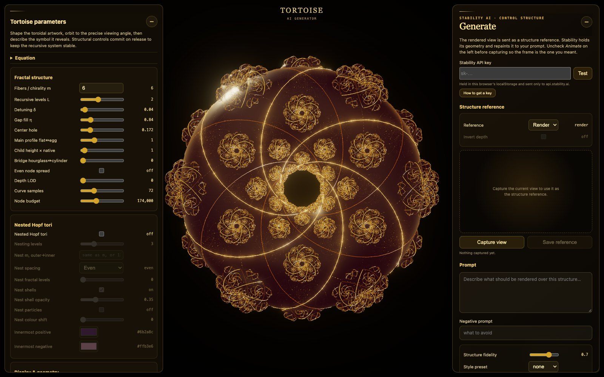

# Tortoise Generator



**Tortoise** is an algorithmic artwork: two oppositely rotated Hopf fibre bundles laid over each other,
with the whole structure repeated again and again at the interstices their intersections form, so that it
becomes a fractal torus. It is part of the [Nameless](https://nurecas.com/nameless.html) project.

The **Tortoise Generator** adds a *phenomenological layer* on top of that structure. You shape the fractal
torus in the browser, orbit to an angle, and send the view to [Stability AI](https://stability.ai) as a
structure reference. Stability keeps the geometry and repaints it to your prompt, so the same blueprint can
come back as a temple, a deity, a flower, a machine or anything you describe.

**Try it:** [nurecas.com/tortoise_generator.html](https://nurecas.com/tortoise_generator.html) ·
**About the artwork:** [nurecas.com/tortoise.html](https://nurecas.com/tortoise.html)

## What you can do

- **Shape the structure.** Fibre count and chirality, recursive levels, detuning, gap fill, centre hole,
  profile, bridge shape and a node budget, all live.
- **Nest it.** Nested Hopf tori with their own chirality per shell, spacing, fractal levels, shells,
  particles and a colour shift towards the innermost shell.
- **Show the crossing lattice.** Join the fibre crossings, the torus centres, or one of two E8 readings
  (the nearest-in-4D shadow, or links across golden shells), as lines, points or both, on the root torus or
  across the nests, in any colour and opacity.
- **Light and frame it.** Gold shading, bloom, colours, camera views with exact top and bottom poles, and
  depth of field.
- **Generate.** Capture the rendered view, or a depth pass of it, then write a prompt and an optional
  negative prompt, and set the structure fidelity, style preset, output format and seed.
- **Keep everything.** Each download comes with a text file holding the full parameter state behind it,
  and the session keeps your last results side by side.

## Run it

It is one HTML file with no build step.

1. Download or clone this repository.
2. Open `index.html` in a desktop browser with WebGL2 (Chrome, Edge, Firefox or Safari).

If the requests to Stability fail when the page is opened straight from disk (`file://`), serve the folder
locally instead:

```bash
python3 -m http.server 8000
```

Then open <http://localhost:8000>. three.js is loaded from the jsDelivr CDN, so an internet connection is
needed either way.

## Get a Stability AI API key

1. Create an account or sign in at [platform.stability.ai](https://platform.stability.ai).
2. Open [Account › API keys](https://platform.stability.ai/account/keys) and copy your key. It starts with `sk-`.
3. Check your credits under [Account › Billing](https://platform.stability.ai/account/credits) and buy more
   if needed. Each image costs 3 credits (the Structure control service).
4. Paste the key into the generator and press **Test**. It shows your balance if the key works.

The same steps are behind the **How to get a key** button in the app.

The key is stored only in your browser's `localStorage` and is sent only to `api.stability.ai`. Nothing
passes through any other server. Treat it like a password, because it can spend your credits, and clear the
field if you use a shared computer.

Images you generate are subject to Stability AI's
[terms of service](https://stability.ai/terms-of-service) and
[acceptable use policy](https://stability.ai/use-policy).

## Credits

- Tortoise and the Tortoise Generator by [nurecas](https://nurecas.com).
- Built with [Claude](https://claude.ai) (Anthropic).
- Rendered with [three.js](https://threejs.org).
- Image generation by [Stability AI](https://stability.ai).

## License

The code in this repository is released under the [MIT License](LICENSE). three.js is MIT-licensed by the
three.js authors; see [THIRD_PARTY_NOTICES.md](THIRD_PARTY_NOTICES.md).
