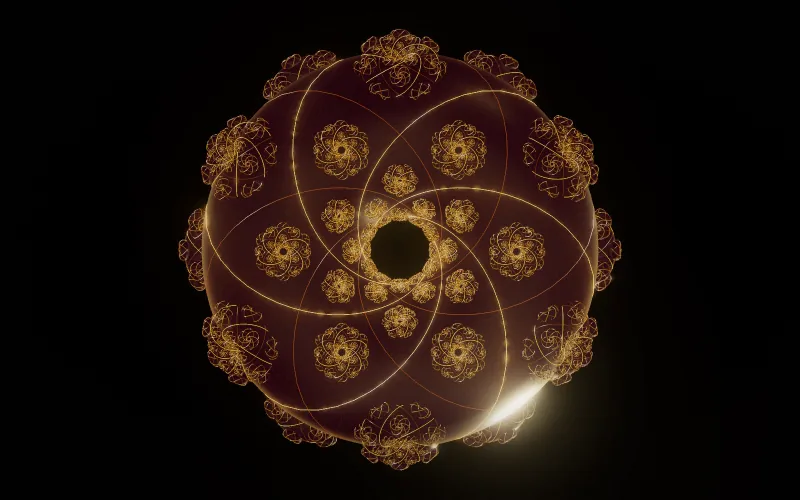
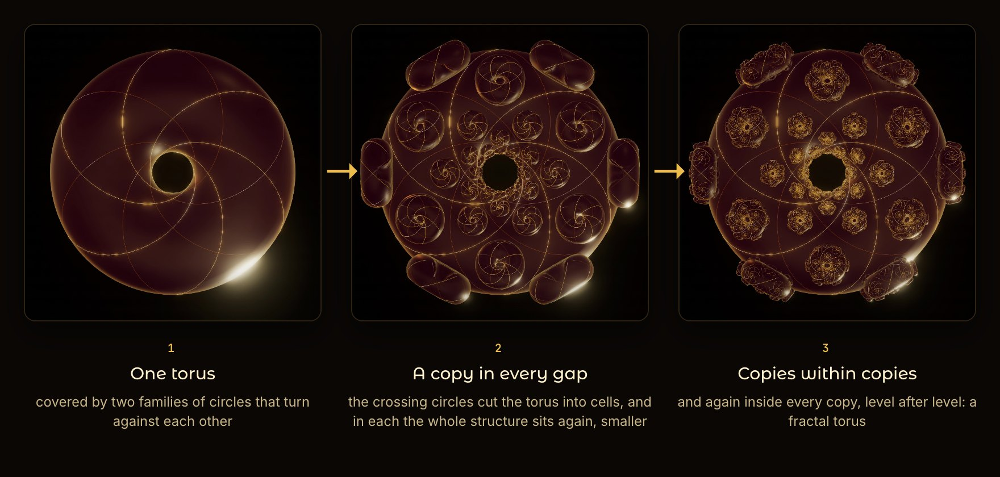
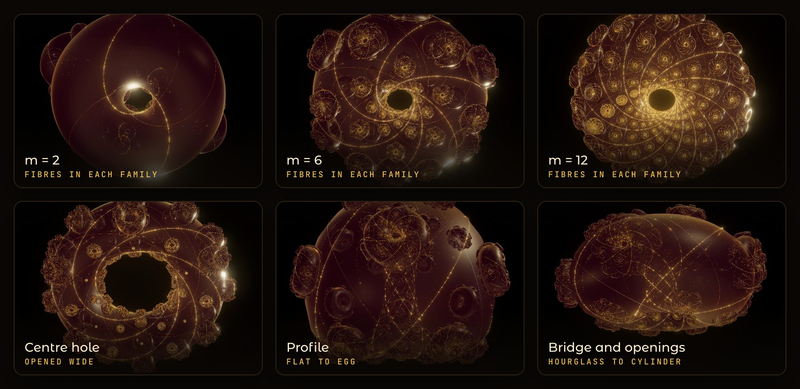
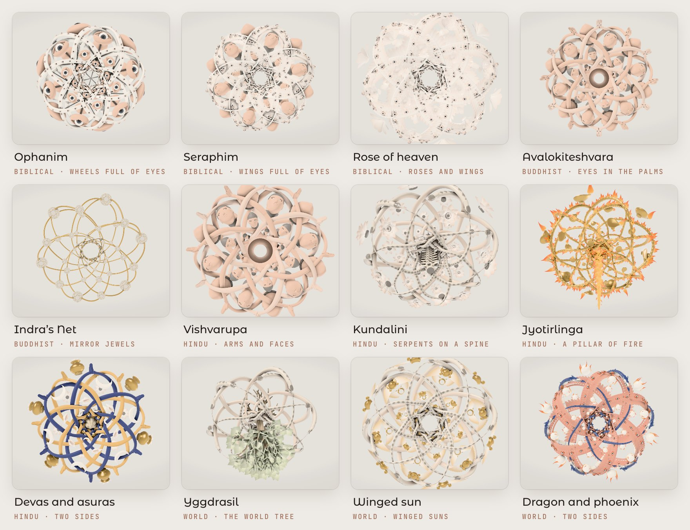
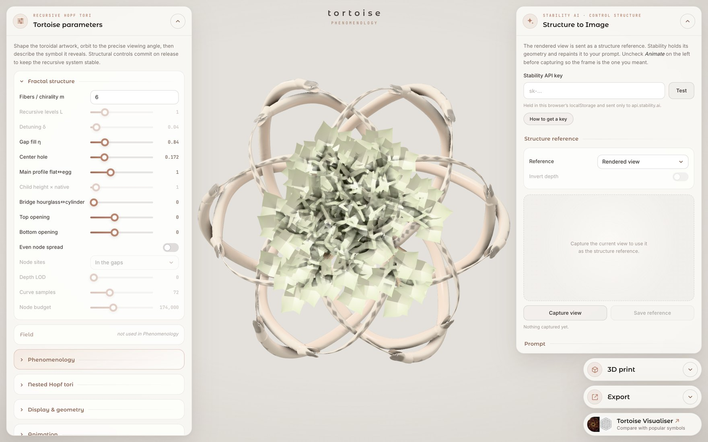
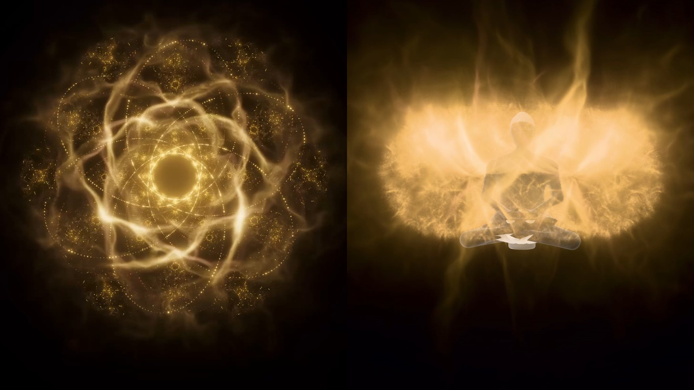
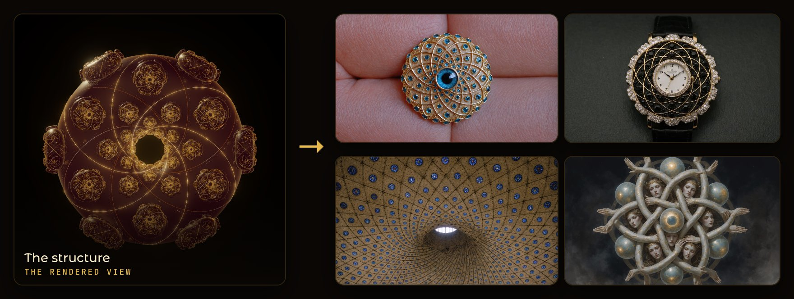
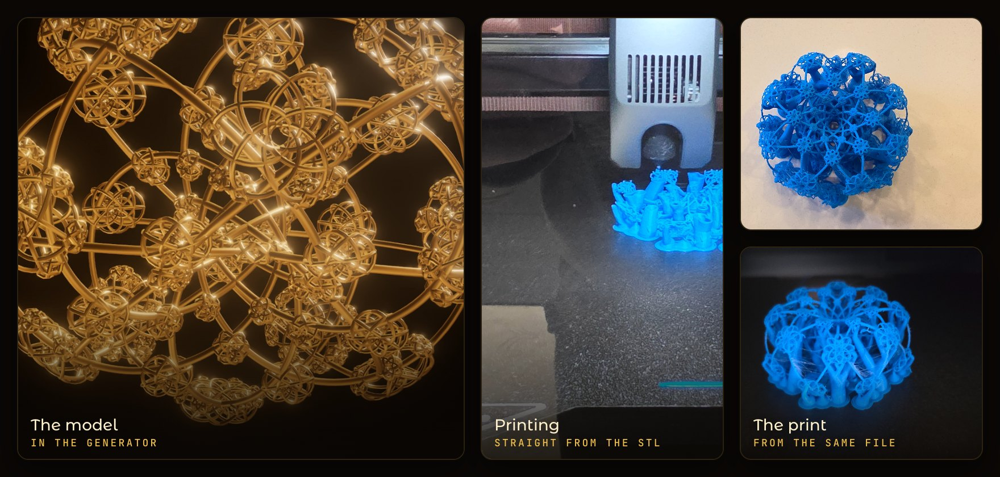
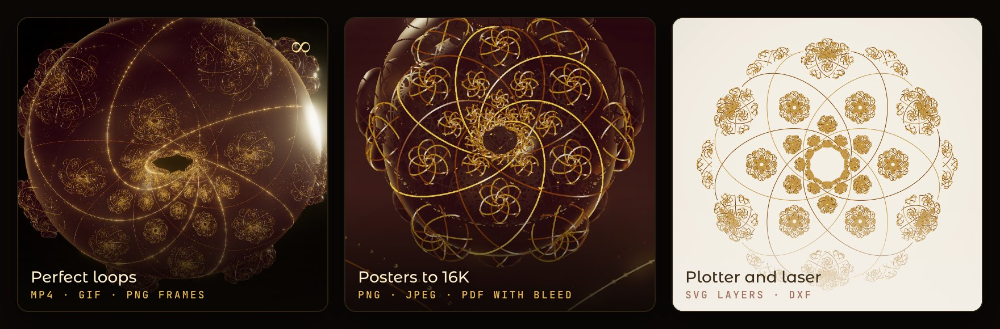

# Tortoise Generator



**Tortoise Generator** grows a fractal torus from one equation, live in your browser. Shape it, see it as
21 of the world's visions, light it as a glowing field, repaint it with AI, 3D print it, and export loops,
posters up to 16K and files for pen plotters and lasers.

It is one HTML file, free and open source under the [MIT License](LICENSE). There is nothing to install,
and nothing is uploaded.

**[Open it on nurecas.com →](https://nurecas.com/tortoise_generator)** ·
[The artwork](https://nurecas.com/tortoise) ·
[Tortoise Visualiser](https://nurecas.com/tortoise_visualiser) ·
[Nameless](https://nurecas.com/nameless)

**Contents:** [What the Tortoise is](#what-the-tortoise-is) · [Shape it live](#shape-it-live) ·
[Phenomenology](#phenomenology-21-visions) · [The field](#the-field) · [Structure to Image](#structure-to-image) ·
[3D print](#3d-print) · [Export](#export) · [The interface](#the-interface) · [Run it yourself](#run-it-yourself) ·
[Stability AI key](#get-a-stability-ai-api-key) · [Privacy](#privacy) · [Credits and license](#credits-and-license)

## What the Tortoise is



The Tortoise is an algorithmic artwork by [nurecas](https://nurecas.com), built in three steps:

1. **One torus, two families of circles.** A torus (a ring shape) can be covered by circles that wind round
   it in two directions at once. They are called *Villarceau circles*, and they are also the fibres of the
   *Hopf fibration*: circles from four-dimensional space, seen in three. The Tortoise lays two families of
   them over each other, one turning each way, and when it moves the two families turn against each other.
2. **A copy in every gap.** The crossing circles divide the torus into small cells, and in each one a
   smaller copy of the whole structure sits, turned to follow the surface. (With *Node sites* the copies
   can sit exactly on the crossings instead.)
3. **Copies within copies.** Every copy has crossings of its own, and gets copies there too, level after
   level. The result is a fractal torus.

`m`, the number of circles in each family, sets the symmetry: seen from above, an `m`-fold rose. The
**Equation** section at the foot of the parameters panel shows the exact formulas behind the drawing.

## Shape it live



Everything redraws as you move it. The **Fractal structure** section holds the shape:

| Control | What it does |
|---|---|
| Fibers / chirality m | the number of circles in each family, and so the symmetry |
| Recursive levels L | how many times copies sit inside copies |
| Detuning δ | turns the circles of each level a little against the level above |
| Gap fill η | how much of its gap each copy fills, and so how large the copies are |
| Center hole | the size of the hole through the middle |
| Main profile flat↔egg | the cross-section, from a flat ring to an egg |
| Child height × native | how tall each copy stands |
| Bridge hourglass↔cylinder | pulls the waist from an hourglass to a cylinder |
| Top opening, Bottom opening | opens either end like a funnel, or closes it like a neck |
| Node sites | copies in the gaps between the circles, or exactly on the crossings |
| Depth LOD, Curve samples, Node budget | detail, and a cap on the number of copies |

The sections below it go further:

- **Nested Hopf tori:** tori inside tori, each shell with its own chirality, spacing, levels and particles,
  and a colour shift towards the centre.
- **Crossing lattice:** joins the crossings, the torus centres, or one of two E8 readings with lines and
  points. At `m = 2` it draws the 16-cell; with the 600-cell preset, the 600-cell.
- **Display & geometry, Gold shading, Colors, Visibility:** background, exposure, fog, the opacity of
  fibres and tori, bloom, sheen, and a colour for each family.
- **Animation:** the speed of the counter-rotation, and particles flowing along the fibres.
- **Camera and Depth of field:** side, top and bottom views with exact poles, and a focus that follows
  the orbit.

**Presets.** *Export preset JSON* saves every setting to a file, and *Import preset JSON* loads one. Two
are in [`presets/`](presets):

- `tortoise-600-cell.json`: five fibres, a nest in golden proportion, and the 600-cell drawn by the
  crossing lattice.
- `tortoise-merkaba-16-cell.json`: two fibres on the Clifford torus, and the 16-cell, whose shadow turns
  from an octahedron into a star tetrahedron as it rotates.

## Phenomenology: 21 visions



Many traditions describe visions that resemble this structure: wheels full of eyes, a god with countless
arms and faces, a net of jewels in which each jewel reflects all the others. Turn on **Phenomenology** and
the same geometry is drawn as such figures instead of lines. The geometry underneath does not change.

Three parts of the structure take a figure each:

- **Fibres become** arms, arms with eyes in the palms, wheels full of eyes, wings full of eyes, serpents,
  dragons, rings of fire, prayer beads, interlace bands, threads of a net, or the glowing field.
- **First-level nodes become** faces, great eyes, lotuses, roses, treasures of the ocean, mirror jewels,
  flaming pearls, lamps, winged suns, skulls, or nothing.
- **The bridge becomes** a body, a spine, a seated figure, a world tree, a mountain on a tortoise, a pillar
  of fire, a staff with two serpents, or nothing.

**Vision** sets all three at once:

| Group | Visions |
|---|---|
| World | Yggdrasil · Winged sun · Dragons and pearls · Dragon and phoenix · Caduceus · Interlace · Yin and yang |
| Buddhist | Avalokiteshvara · Indra's Net · Bodhi tree |
| Hindu | Vishvarupa · Kundalini · Ida and Pingala · Samudra Manthan · Devas and asuras · Jyotirlinga · Kali |
| Biblical | Ophanim · Seraphim · Rose of heaven |
| Field | The human in the torus |

- **Two sides.** Each fibre family can be its own figure in its own colour (*Other family*, *First family
  colour*, *Other family colour*). Devas and asuras, Dragon and phoenix, Ida and Pingala, and Yin and yang
  are made this way.
- Where fibres of the two families cross, their bodies weave over and under each other, and the weave
  slides with the rotation.
- *Centre size* scales the figure on the axis, *Eyes follow you* turns the eyes towards the camera, and soft
  shadows, a flesh tone and a paper background give the mode its own light.



## The field



**Field view** draws the structure as light. The field is computed in the Hopf coordinates of every torus,
so it follows the same circles: a shell round each torus, ridges along the two families, filaments and
spikes, a haze, pulses that travel along the lines, plasma, and a heartbeat. Show it as a *Glow over the
structure* or as the *Field only*. The vision *The human in the torus* seats a figure inside it.

## Structure to Image



Send the current view to [Stability AI](https://stability.ai) as a *structure reference*. Stability keeps
the geometry and repaints it to your prompt, so the same form can come back as jewellery, architecture, a
painting or anything else you describe.

1. Orbit to the view you want and press **Capture view**. The reference is the rendered view, or a depth
   pass of it.
2. Write a prompt, and a negative prompt if you like. Set the structure fidelity, a style preset, the output
   format and a seed.
3. Press **Generate** (3 credits an image). Each image can be downloaded with a text file of every
   parameter behind it, and the session keeps your results side by side.

This is the only part of the generator that sends anything anywhere: to Stability, with your own key. See
[Get a Stability AI API key](#get-a-stability-ai-api-key).

## 3D print



The **3D print** panel turns the frame on screen into one watertight solid, built in your browser:

- The fibres become tubes, **fused at every crossing**. Smaller copies are joined to their parents by struts,
  or grown until they touch. Copies too small to print are left out.
- **Method** presets for a print service (nylon), a resin printer, a filament printer or metal casting set
  the size and thicknesses. *Custom* lets you set each one.
- A **base** (a round or square plinth, or a flattened bottom) and an **engraving** in serif, sans or mono
  lettering.
- **Finishing:** a hanging loop, hollowing with drain holes, and splitting into two to four parts with
  alignment pegs, laid flat on their cuts.
- **Download STL** or **3MF**.

The solid is built with [Manifold](https://github.com/elalish/manifold) (WebAssembly) in a background worker;
very large models, of about five million triangles, are its limit. Phenomenology figures are not printed:
the model is always the structure itself.

## Export



The **Export** panel takes the artwork off the screen as it is now:

- **Loops:** MP4, GIF or zipped PNG frames, square, portrait, tall, wide or the window's shape, from 480 px
  to 4K. Every moving part completes a whole number of its own cycles, so the last frame runs straight into
  the first. The camera can stay still or go once round the artwork.
- **Posters:** 4K to 16K (15,360 px), or paper from A3 to A0, 50 × 70 cm, 70 × 100 cm, US Letter, Tabloid
  and squares, at 300 dpi. PNG, JPEG, or a PDF for printing with 3 mm bleed and crop marks. Big posters are
  drawn in tiles, with no seams.
- **Lines for a plotter or laser:** SVG for a pen plotter (one Inkscape layer per pen, with a pen for each
  fibre family if you like), SVG for a laser, or DXF. Lines hidden behind the tori can be left out, and the
  pen's travel is put in order.

Lines, glow and particles are scaled with the picture, so a poster looks like the screen, only sharper.

## The interface


- **Left:** *Tortoise parameters*, in folding sections: Fractal structure, Field, Phenomenology, Nested Hopf
  tori, Display & geometry, Animation, Gold shading, Camera, Depth of field, Colors, Visibility and Crossing
  lattice, with the presets and the Equation at its foot.
- **Right:** *Structure to Image*, *3D print* and *Export*. Each panel folds into a small pill when you don't
  need it.
- **Mouse:** drag to orbit, scroll to zoom, and right-drag to pan. On a touch screen, one finger orbits and
  two zoom and pan.

## Run it yourself

The live version is at **[nurecas.com/tortoise_generator](https://nurecas.com/tortoise_generator)**. To run
your own copy:

1. Download or clone this repository.
2. In its folder, start a small local web server with the command below.
3. Open <http://localhost:8000> in a desktop browser.

```bash
python3 -m http.server 8000
```

Opening `index.html` straight from disk works too, except for the 3D print, which browsers allow only on a
served page. three.js, Manifold and the fonts are loaded from CDNs, so an internet connection is needed
either way.

**Browsers:** a recent desktop Chrome, Edge, Firefox or Safari with WebGL 2. MP4 export needs WebCodecs, and
the 3D print needs WebAssembly. It runs on phones and tablets, but a computer with a good graphics card is
the comfortable place for it. If it feels slow, lower the *Pixel ratio* (in Display & geometry) or the
*Recursive levels*.

## Get a Stability AI API key

1. Create an account or sign in at [platform.stability.ai](https://platform.stability.ai).
2. Open [Account › API keys](https://platform.stability.ai/account/keys) and copy your key. It starts with `sk-`.
3. Check your credits under [Account › Billing](https://platform.stability.ai/account/credits), and buy more
   if needed. Each image costs 3 credits (the Structure control service).
4. Paste the key into the *Structure to Image* panel and press **Test**. It shows your balance if the key works.

The same steps are behind the **How to get a key** button in the panel.

Images you generate are subject to Stability AI's [terms of service](https://stability.ai/terms-of-service)
and [acceptable use policy](https://stability.ai/use-policy).

## Privacy

Everything runs in your browser. The code in this repository has no accounts and no analytics, and it
uploads nothing, except the requests *Structure to Image* sends to `api.stability.ai` with your key. The key
is kept only in your browser's `localStorage`. Treat it like a password, because it can spend your credits,
and clear the field if you use a shared computer.

## Credits and license

- Tortoise and the Tortoise Generator by [nurecas](https://nurecas.com). The Tortoise is part of
  [Nameless](https://nurecas.com/nameless), a project and a [book](https://nurecas.com/book).
- Built with [Claude](https://claude.ai) (Anthropic).
- Rendered with [three.js](https://threejs.org). Solids by [Manifold](https://github.com/elalish/manifold).
  Image generation by [Stability AI](https://stability.ai).

The code in this repository is released under the [MIT License](LICENSE). The libraries it loads keep their
own licenses; see [THIRD_PARTY_NOTICES.md](THIRD_PARTY_NOTICES.md).
